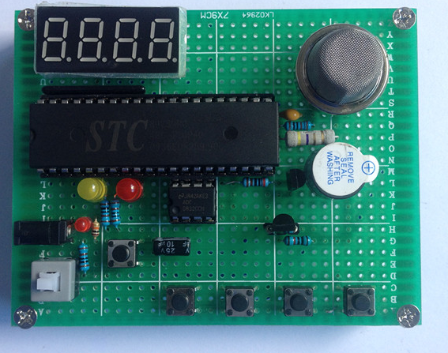

# 基于 AT89C52 的室内环境监测报警系统

51 单片机课程设计：DS18B20 采温度、MQ-2 采烟雾/可燃气体浓度，数码管实时显示，超阈值声光报警，报警阈值可由按键设置并掉电保存。



*4 位数码管 + STC89C52 + MQ-2 + 4 键，洞洞板焊接调试完成*

## 功能

| 功能 | 说明 |
|---|---|
| 温度采集 | DS18B20 单总线，精度 0.0625℃，范围 -55~+125℃ |
| 气体采集 | MQ-2 半导体气敏传感器，输出模拟电压经 ADC0832 转 8 位数字量 |
| 显示 | 4 位共阴数码管动态扫描，前两位显示烟雾等级（0~9），后两位显示温度（℃） |
| 阈值设置 | 4 个独立按键：设置 / 加 / 减 / 紧急报警；30 秒无操作自动退出并保存 |
| 报警 | 超烟雾阈值：蜂鸣器滴滴 + 红灯闪烁；超温度阈值：蜂鸣器 + 黄灯；支持手动紧急报警 |
| 掉电保存 | 阈值与标志位写入 STC89C52 片内 EEPROM（0x2000 起），上电自动读回 |

## 硬件

| 器件 | 型号 | 数量 | 作用 |
|---|---|---|---|
| 主控 | AT89C52 / STC89C52 | 1 | 12MHz 晶振，最小系统 |
| 温度传感器 | DS18B20 | 1 | 单总线数字温度 |
| 气敏传感器 | MQ-2 | 1 | 烟雾 / 可燃气体，需预热 |
| 模数转换 | ADC0832 | 1 | 8 位串行 AD |
| 显示 | 4 位共阴数码管 | 1 | 动态扫描 |
| 报警 | 有源蜂鸣器 + LED×2 | 1+2 | 声光报警 |
| 交互 | 独立按键 | 4 | 设置 / 加 / 减 / 紧急 |
| 供电 | 5V 直流 | 1 | — |

## 引脚分配

| 功能 | 引脚 | 备注 |
|---|---|---|
| DS18B20 DQ | P1.5 | 外接 4.7kΩ 上拉到 5V |
| ADC0832 CS / SCL / DO | P2.3 / P2.0 / P2.1 | 软件模拟 SPI 时序 |
| 数码管段选 | P0 | P0 需外接排阻上拉 |
| 数码管位选 | P2.4 ~ P2.7 | 动态扫描，定时器中断刷新 |
| 蜂鸣器 | P3.6 | NPN 三极管驱动 |
| 温度报警灯（红） | P1.6 | — |
| 烟雾报警灯（黄） | P1.7 | — |
| 按键 | P1 口 4 路 | 按下拉低，软件消抖 |

完整接线见 [docs/接线表.md](docs/接线表.md)。

## 软件结构

```
main()
 ├─ 初始化：IO 置高 → 读 EEPROM → 首次上电写默认阈值 → LCD/数码管初始化 → 定时器
 └─ while(1)
     ├─ key()            按键扫描 + 消抖
     ├─ key_with()       按键动作（进入设置 / 加减阈值 / 手动报警）
     ├─ 每 300ms：
     │   ├─ clock_h_l()  阈值比较 + 声光报警 + 状态位
     │   ├─ read_temp()  DS18B20 读温度
     │   └─ ad0832read() 读烟雾模拟量 → 换算等级
     └─ 数码管动态扫描（定时器中断）
```

## 关于源码（先看这段）

`src/main.c` 是**论文附录收录的核心代码**，包含：延时、EEPROM 读写与初始化、DS18B20 初始化与读温、主循环。它**不是可直接编译的完整工程**——ADC0832 读取、按键扫描、数码管动态扫描中断、报警比较这几个函数因论文篇幅未收录，完整 Keil 工程在课程结束后未单独留存。

它的正确用法是：

- 对照 [docs/接线表.md](docs/接线表.md)，看清每个引脚在代码里对应哪一行 `sbit`
- 面试时讲清数据流：**采集 → 换算 → 比较 → 显示/报警/存储**，这条链路在两个版本里是一样的
- 若要在本地跑起来，按接线表重建工程，缺的函数可参考同账号 `wifi-fire-alarm` 仓库里的同类实现（`ad0832read`、`key`、`clock_h_l` 逻辑同源）

## 如需重建工程

1. Keil uVision5 新建 C51 工程，芯片选 `AT89C52`，晶振 `12MHz`
2. 加入 `src/main.c`，补上 `eeprom52.h` 与未收录的函数
3. Build 生成 `.hex`
4. STC-ISP 选择串口与芯片型号，波特率 2400~115200，下载后**断电再上电**（STC 需冷启动）

## 实测记录

- 温度：与标准温度计对比，误差 ≤ ±1℃
- 烟雾：打火机放气靠近 MQ-2，等级显示稳定上升，超过 4 级触发报警
- 报警响应：超阈值后 ≤ 1s 内蜂鸣器与指示灯动作
- 掉电保存：修改阈值后断电 10s 再上电，阈值保持

## 遇到的问题

全部整理在 [docs/排错记录.md](docs/排错记录.md)，包括 DS18B20 读 85℃、MQ-2 上电漂移误报、数码管闪烁、按键抖动、阈值丢失等 7 个真实故障与处理过程。

## 后续可做

- 加 ESP8266 上云（见同账号仓库 `wifi-fire-alarm`，已实现 WiFi 上报 + 手机端查看）
- 加 DHT11 补湿度、LCD1602 替换数码管提升可读性
- MQ-2 换成 MQ-135 或电化学传感器，提升选择性

## 声明

本项目为本科课程设计，代码基于课内例程修改整理，仅用于学习记录与技术交流。硬件方案参考公开资料，未用于任何商业用途。